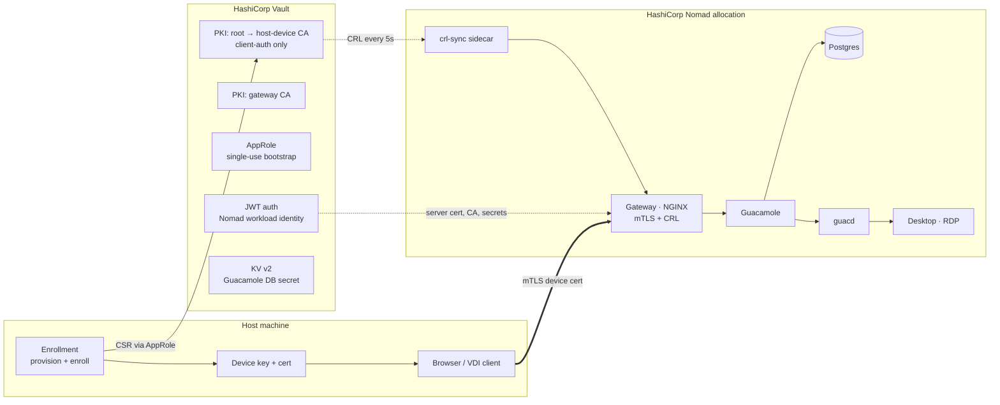

# Device-trusted VDI with HashiCorp Vault and HashiCorp Nomad

**Use case:** a host machine must be *known to the organization* before a virtual desktop session can start.

HashiCorp Vault issues each managed host a short-lived device certificate. A gateway running on HashiCorp Nomad enforces mutual TLS in front of an open-source VDI broker (Apache Guacamole). Unknown, forged or revoked hosts never reach the broker.



| What the audience sees | What makes it work |
| --- | --- |
| Unmanaged laptop → blocked page, no desktop | `ssl_verify_client on` against the Vault device CA only |
| Admin provisions the laptop, laptop enrolls itself | Response-wrapped, single-use AppRole Secret ID; key generated on the host, only the CSR goes to Vault |
| Known laptop → Guacamole → Ubuntu desktop | Vault-issued, client-auth-only, 72h device cert |
| Forged cert with identical names → blocked | Trust comes from the issuer's key, not the name (`certificate signature failure`) |
| "Laptop stolen" → revoke → cut off in seconds | Vault CRL pulled every 5s by a sidecar, NGINX hot-reloads, TLS session resumption disabled |
| No secrets in the job file | Nomad workload identity → Vault JWT auth → `pkiCert` / `secret` templates |

Everything on the Vault side uses Vault Community Edition features. The defaults target HCP Vault Dedicated, where everything lives in the `admin` namespace; set `vault_namespace = ""` (Terraform and Nomad) and `VAULT_NAMESPACE=""` (scripts) to use the root namespace of a self-managed Vault.

---

## Repository layout

```
terraform/   Vault configuration: PKI hierarchy, roles, AppRole, Nomad JWT auth, policies, KV
nomad/       The Nomad job (gateway, CRL sidecar, Guacamole, guacd, Postgres, desktop) + agent config example
device/      Python scripts playing the host device, the admin and the attacker
```

## Prerequisites

* A running Vault you can configure with an admin token (`VAULT_ADDR`, `VAULT_TOKEN`, `VAULT_NAMESPACE`). On HCP Vault Dedicated, use the cluster's public address and the `admin` namespace.
* HashiCorp Nomad 1.7 or later (workload identity for Vault), with:
  * the Docker driver on the client,
  * CNI reference plugins installed (the job uses `bridge` networking),
  * the `vault` block in the agent config (see `nomad/agent-vault.hcl.example`).
* Terraform 1.5 or later.
* Python 3.10 or later on the demo laptop.
* Vault must be able to reach Nomad's JWKS URL, and the Nomad client must be able to reach Vault. With HCP Vault Dedicated, the JWKS URL must be reachable from HCP (public endpoint, or through an HVN peering / transit gateway).

---

## 1. Configure Vault (Terraform)

```bash
cd terraform
cp terraform.tfvars.example terraform.tfvars   # edit: vault_public_addr, nomad_jwks_url
export VAULT_ADDR=https://<cluster>.<id>.z1.hashicorp.cloud:8200
export VAULT_TOKEN=<admin token>
export VAULT_NAMESPACE=admin
terraform init
terraform apply
```

**Already integrated Nomad with Vault** (for example with `nomad setup vault`)? Set `create_nomad_jwt_auth = false` and `nomad_jwt_auth_path` to your existing mount. Terraform then only adds a demo role, bound to the `device-trust-vdi` job, to that mount.

What gets created:

| Path | Purpose |
| --- | --- |
| `pki-demo-root` | Root CA (EC P-384) |
| `pki-devices` + role `host-device` | Device intermediate. Client-auth only, `<id>.devices.demo.local` only, 72h default TTL |
| `pki-gateway` + role `gateway` | Intermediate for the gateway's server certificate |
| `auth/approle-devices` role `host-enrollment` | Single-use Secret IDs, 15-minute tokens that can only `sign` a device CSR |
| `auth/jwt-nomad` role `device-trust-vdi` | Lets only the `device-trust-vdi` job read what it needs |
| `kv-device-trust/guacamole` | Random Guacamole DB password |
| Policy `device-trust-admin` | Least-privilege policy for the presenter's admin persona |

## 2. Deploy the Nomad job

```bash
cd nomad
cp device-trust-vdi.vars.hcl.example device-trust-vdi.vars.hcl   # edit: vault_addr, vault_namespace, gateway_ip_sans
nomad job run -var-file=device-trust-vdi.vars.hcl device-trust-vdi.nomad.hcl
nomad alloc logs -f -task gateway <alloc-id>      # watch device verdicts live
```

Put the Nomad client's IP in `gateway_ip_sans`. On the demo laptop, map the gateway name:

```bash
echo "192.168.1.50  vdi.demo.local" | sudo tee -a /etc/hosts
```

The first start pulls about 2 GB of images, mostly the desktop image.

## 3. Prepare the demo laptop

```bash
cd device
python3 -m venv .venv && source .venv/bin/activate
pip install -r requirements.txt

export VAULT_ADDR=https://<cluster>.<id>.z1.hashicorp.cloud:8200
export VAULT_NAMESPACE=admin                     # default; "" for a root-namespace Vault
export DT_GATEWAY_URL=https://vdi.demo.local:8443
# export VAULT_CACERT=/path/to/vault-ca.pem      # if Vault uses a private CA
eval "$(cd ../terraform && terraform output -raw device_script_env)"   # mount names, if you changed them
```

Run the admin steps (`provision`, `list`, `revoke`) with `VAULT_TOKEN` set to a token carrying the `device-trust-admin` policy:

```bash
vault token create -policy=device-trust-admin -ttl=8h -field=token
```

---

## Demo runbook (about 10 minutes)

Use two terminals: **Admin** (with `VAULT_TOKEN`) and **Laptop** (without it). Keep a browser on `https://vdi.demo.local:8443`.

**1. An unknown host is turned away.**

```bash
python access_gateway.py --no-cert
```

> "This laptop isn't managed. The gateway rejects it before Guacamole, or any desktop, is involved."

In the browser, the black-and-yellow *This device is not known to the organization* page appears, showing the gateway's verdict.

**2. Admin registers the host.** (Admin terminal)

```bash
VAULT_TOKEN=... python provision_device.py laptop-0042
```

> "This is the step MDM would do: Vault mints a one-time, response-wrapped bootstrap credential bound to this asset tag. Even the admin never sees the secret."

**3. The host enrolls itself.** (Laptop terminal)

```bash
python enroll_device.py laptop-0042
```

> "The key is generated on the device (in production, inside the TPM) and only the CSR goes to Vault. Vault signs a client-auth-only cert with a 72h TTL. The bootstrap credential is now burned."

Run it again to show that a replayed bootstrap credential fails.

**4. The known host gets a desktop.**

```bash
python access_gateway.py --device laptop-0042
```

Then the visual version: import `device/devices/laptop-0042/device.p12` (password `demo`) into the browser, reload `https://vdi.demo.local:8443`, choose the certificate, log in to Guacamole (`guacadmin` / `guacadmin`), and open **Corporate desktop (Ubuntu XFCE)**.

> "Two layers: the device proved itself to the gateway, then the user logs in. In production that second step is your SSO."

**5. A forged identity fails.**

```bash
python rogue_device.py laptop-0042
```

> "Same device name, a fake CA with the same name as ours: rejected with `certificate signature failure`. Trust comes from Vault's key, not from names."

**6. Inventory.** (Admin terminal)

```bash
python list_devices.py
```

**7. The lost-laptop moment.** Start a watcher on the Laptop terminal:

```bash
python access_gateway.py --device laptop-0042 --watch 1
```

Then revoke from the Admin terminal:

```bash
python revoke_device.py laptop-0042
```

The watcher flips from **ALLOWED** to **BLOCKED (certificate revoked)** within about 5 seconds, and the gateway log shows `CRL changed, NGINX reloaded`.

> "That cert had three days left. Revocation in Vault cut the host off in seconds, with no change to the gateway and nobody touching the laptop."

> **Presenter note:** an RDP session that is *already open* runs over a long-lived WebSocket, so it continues until it disconnects; revocation stops every *new* connection. Real VDI gateways behave the same way, and it's worth saying so out loud. Close the tab and reconnect to show the block in the browser.

---

## How the gateway enforces device trust

* `ssl_client_certificate` contains **only** the `pki-devices` intermediate plus the root, rendered by Nomad from Vault. Certificates from any other issuer fail.
* `ssl_crl` points at a bundle of the root CRL and the device CRL. NGINX checks the whole chain, so both are required. The `crl-sync` sidecar pulls them from Vault's unauthenticated CRL endpoints every `crl_refresh_seconds`. The gateway's start script reloads NGINX when the bundle changes.
* `ssl_session_cache off`, `ssl_session_tickets off` and a short keep-alive mean every new connection is fully re-verified, so a revoked device can't ride on a resumed TLS session.
* Status codes 495 and 496 (bad or missing cert) are turned into a branded 403 page. The `X-Device-Verify` header and the access log carry the exact reason, which gives you an audit trail of which device tried what.
* `/__device` returns the verified identity as JSON. The scripts use it, and so can you, with `curl --cert`.
* The gateway's own server certificate comes from `pkiCert` against `pki-gateway`. Nomad renews it and reloads NGINX through a `change_script`.

**Why CRL rather than OCSP?** Vault serves OCSP, but NGINX's built-in OCSP client only talks to plain-HTTP responders, while most Vault clusters are HTTPS-only. The CRL sidecar works with any Vault. With a gateway that supports HTTPS OCSP (NetScaler, F5, Envoy), point it at `<vault>/v1/admin/pki-devices/ocsp` instead (drop `admin/` on a root-namespace Vault).

## Taking it to production

| Demo shortcut | Production equivalent |
| --- | --- |
| Private key in a file on the laptop | Key generated in the TPM (Windows Platform Crypto Provider, macOS Secure Enclave), non-exportable |
| AppRole bootstrap via `provision_device.py` | Vault Enterprise SCEP or EST profiles pushed by Intune or Jamf, or the cert auth method exchanging an existing machine identity |
| Any enrolled device can request any `*.devices.demo.local` name | Bind the identity to the bootstrap credential: a per-device role, or a Sentinel EGP in Vault Enterprise that checks the CN against the Secret ID's `device_id` metadata |
| Manual re-enrollment at expiry | Vault Agent on the host, re-authenticating with the current cert (cert auth) and renewing before expiry |
| Self-hosted NGINX in front of Guacamole | Your VDI gateway (NetScaler, Omnissa UAG) with the same CA and revocation configuration |
| Guacamole DB login | Guacamole OIDC or SAML extension, so device trust and user SSO are both enforced |
| Root CA inside Vault | Offline or HSM-backed root, with Vault holding only the intermediates |

## Troubleshooting

| Symptom | Check |
| --- | --- |
| Allocation pending | CNI plugins on the client (`bridge` mode), and that port 8443 is free |
| Template errors on `gateway`, `postgres` or `guacamole` | Nomad's `vault` agent block (`namespace = "admin"` on HCP) and `jwt_auth_backend_path`, the role's `bound_claims` (job ID and namespace), and that Vault can reach the JWKS URL |
| Gateway stuck at "waiting for CRL bundle" | `nomad alloc logs -task crl-sync`: Vault reachability and TLS (`vault_ca_pem`, or `vault_tls_skip_verify` in a lab) |
| Scripts say "could not verify the gateway's server certificate" | Delete `device/trust/root-ca.pem` so it is re-fetched; check that the hostname or IP you use is in the gateway cert (`gateway_ip_sans`) |
| Browser doesn't offer the cert | Import `device.p12` into the OS store or browser; the gateway only lists the Vault device CA as acceptable |
| Guacamole login fails | `nomad alloc logs -task postgres`; the database is re-initialized on each new allocation |

## Clean up

```bash
nomad job stop -purge device-trust-vdi
cd terraform && terraform destroy
rm -rf device/devices device/trust
```
